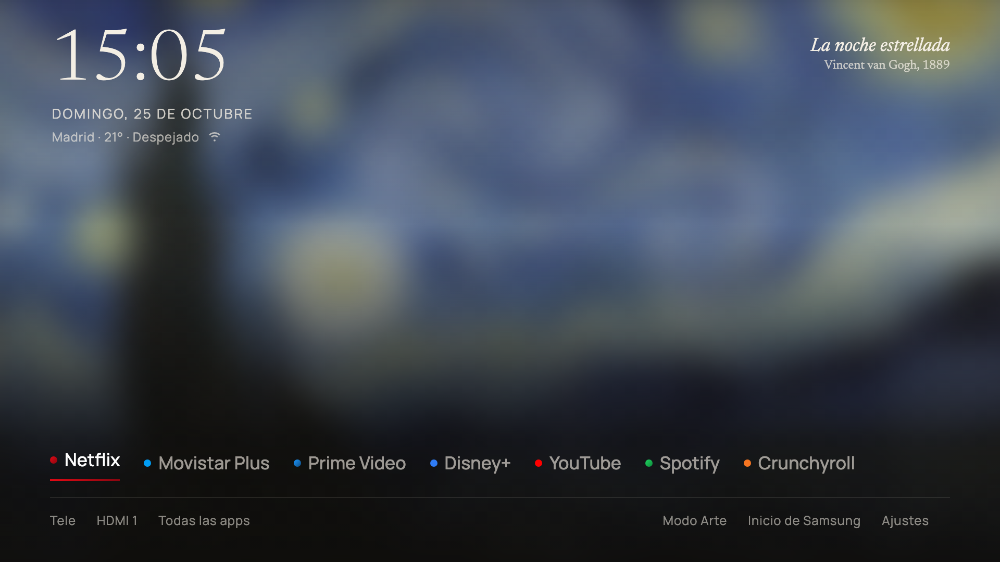

# ArtHome

A home screen for the Samsung The Frame that uses the artwork on display in Art Mode as its
background. It's built on [AeroTizen](https://github.com/helalaou/AeroTizen) 2.3.0 by
**Hamza El Alaoui** (MIT licence). ArtHome keeps AeroTizen's base: the launcher app, the
background service that opens it at power-on and when you press Home, the Art Mode guard, and
the command-line tool that installs it from a computer. The interface on top is new.



It was made for one TV: a **The Frame 65" from 2022** (TQ65LS03BGUXXC, Tizen 6.5, firmware
1720.7) in Spain. The interface is in **Spanish**. Code comments and commit messages are in
Spanish too; the documentation is in English.

## What it does

**Home screen ("Galería")**

- The background is the artwork the Art Mode is showing, blurred. Next to it there's a gallery
  label with title, author and year. The TV only knows its own ID (`MY_F0039`), so the label
  comes from a built-in list. That list can be edited without reinstalling.
- Time, date, weather (Open-Meteo, no account needed) and network type sit in the top left.
- A row of your apps in your own order. You can set names and colours for each app.
- A bottom bar with the inputs (TV, HDMI with their own names; HDMI ports with nothing
  connected are hidden), **All apps**, **Art Mode** (one press and the TV goes to Art Mode),
  **Samsung Home** (Samsung's own home screen, if you ever need it) and **Settings**.
- It shows instantly on return: the last app list and background are cached, then refreshed.

**All apps ("Catálogo")**

- Apps grouped like a museum catalogue: Cinema & series, TV, Music & video, Other.
- A side card for the focused app, with its artwork from the TV.
- **OK opens a menu:** open, add to or remove from Home, change its position on Home, rename,
  change its colour, go back to the original name, hide or unhide.
- Hidden by default: Rakuten TV, Xbox, GeForce NOW, Amazon Luna and e-Manual.

**Settings**

- Home (which apps, the Art Mode and Samsung Home buttons), background (blur strength, label
  on/off), colours, the watcher switch, TV and inputs, time and weather, and an About page
  with the AeroTizen credit.
- **TV settings** sends the remote's Menu key, so Samsung's full settings open on top of
  ArtHome.
- **One switch for everything automatic:** "open ArtHome at power-on and with Home". When
  it's off, the service stops watching and ArtHome becomes an ordinary app. Any watcher added
  in the future has to obey this same switch.
- **Backup:** settings are saved to the TV's service after every change and at start-up.
  After a reinstall they come back by themselves. "Send the backup to the computer" and
  "Restore" are in About.

**Rules it follows**

- The Frame remote has no colour buttons, so everything works with the arrows, OK, Back and
  Home.
- Back never closes ArtHome.
- It never sends remote keys while the TV is in Art Mode (the permission prompt would be
  invisible and the TV would mark the connection as refused).
- Live TV and HDMI switch the source and open Samsung's own viewer (`org.tizen.tv-viewer`).
  Drawing the TV inside the launcher froze on this model.
- Chromium 85 on this TV is slow, so effects are drawn once. The blur is done on a
  384×216 canvas and the browser stretches it; nothing is filtered live.

Removed from AeroTizen: its animated backgrounds, fireplace tile, Preact settings, card
layouts and the colour-button shortcuts.

## Where we left off (2026-10-25)

**Working and in daily use** on the TV above: ArtHome 1.1 (package 3.1.0).

| Area | State |
|---|---|
| Home screen, All apps, Settings | ✓ done |
| Opens at power-on | ✓ ("Start with Smart Hub" is off on the TV, and ArtHome is first in Samsung's app row) |
| Home returns to ArtHome | ✓ from Netflix, YouTube and Spotify. ⚠ Disney+ and Prime Video stay "visible" in Samsung's 2022 preview window, so Home doesn't come back from them |
| Shortcut button | ✓ the **Samsung TV Plus** button on the remote brings ArtHome back from any app. TV Plus flashes on screen for a moment, and that can't be avoided |
| Art Mode | ✓ button, background and label. The Frame guard is AeroTizen's original (two fresh checks, 1.5 s grace) and stays as it is: a faster version reopened ArtHome over Art Mode |
| Artwork list without reinstalling | ✓ pushed from the computer over developer mode |
| Settings backup | ✓ to the computer and back |

**Still open**

- Confirm whether Disney+ → Home now comes back (the watcher did see the change once the
  store numbers were in).
- Prime Video sends a `touchDisable` notice on the remote channel when you press Home; the
  service could listen for it.
- Repeat the Home test for Movistar Plus+, Crunchyroll and Atresplayer with their store
  numbers.
- `launcher/js/tienda.js` (app ID → store number) is generated from **this** TV's app list.
  On another TV it must be regenerated. Making that automatic is the main step to make
  ArtHome work on other TVs.
- A button for TizenTube (YouTube without ads through TizenBrew).
- Edit artwork titles and authors from ArtHome itself.
- An English interface.
- The computer-side helper scripts (artwork list upload, backup receiver, test probes) are
  not in this repository yet.
- Not ArtHome, but same project: block Samsung's ads and viewing tracking in the router, for
  the TV only. The domain rounds are in [findings](docs/arthome/findings.md#ads-and-tracking).
- AeroTizen's tests in `tests/` still target its own launcher and haven't been updated for
  ArtHome.

**Decided against:** root, changing which app the Home button opens (it needs undocumented
internal settings), replacing Samsung TV Plus with our own app (the TV only accepts the
version Samsung signs), and an observer that logs everything the TV does.

## Documentation

- [How to connect the TV to the computer](docs/arthome/connect.md): developer mode, the Host
  PC IP, certificates, installing, pushing data and debugging.
- [Findings](docs/arthome/findings.md): what this TV allows and what it doesn't, learned while
  building ArtHome.
- [App list](docs/arthome/apps.md): the apps on the TV, their IDs and store numbers, and
  which ones come back with Home.
- [Artwork list](docs/arthome/artworks.md): the 42 works in "My Photos" and their labels.
- [Original AeroTizen README](docs/aerotizen-readme.md): the CLI (`aerotizen`) and its setup
  are unchanged.

## Install

You need a computer on the same network as the TV, and Python 3.10 or newer.

```bash
python3 -m venv .venv-aerotizen
.venv-aerotizen/bin/pip install .
.venv-aerotizen/bin/aerotizen certs
.venv-aerotizen/bin/aerotizen --tv <TV IP> install ./launcher
```

Before that, turn on developer mode with the Host PC IP set to your computer; the full steps are
in [connect.md](docs/arthome/connect.md). ArtHome installs as `DclHome001.Home`, the same app
ID as AeroTizen, so it replaces AeroTizen and keeps its settings if it's signed with the same
certificate.

To remove it: Settings → "open ArtHome at power-on and with Home" off, then uninstall it from
Apps → Settings on the TV.

## Repository layout

| Path | What |
|---|---|
| `launcher/` | ArtHome: `index.html`, `js/`, `css/`, `fonts/` (Newsreader and Manrope, OFL) and `service/` (the background service) |
| `launcher/js/obras.js` | Built-in artwork labels |
| `launcher/js/tienda.js` | App ID → store number for this TV |
| `src/aerotizen/` | AeroTizen's CLI, unchanged |
| `tools/servicio-pruebas.js` | Runs the service on the computer, read-only against the TV, to preview ArtHome in a browser |
| `dns/` | AeroTizen's DNS blocklists |
| `docs/arthome/` | This project's documentation |

To preview on the computer: serve `launcher/` (for example `npx serve -l 4800 launcher`) and,
in another terminal, `ARTHOME_TELE=<TV IP> node tools/servicio-pruebas.js`.

## Credits

- **[AeroTizen](https://github.com/helalaou/AeroTizen) by Hamza El Alaoui**: the base of
  ArtHome (launcher, service, Art Mode guard, CLI), MIT licence. The copyright notice is kept
  in [LICENSE](LICENSE).
- AeroTizen's own credits: [LTvLauncher](https://github.com/leanbitlab-org/LtvLauncher),
  [Apps2Samsung](https://github.com/Apps2Samsung/Apps2Samsung),
  [tizen-sdb](https://github.com/PatrickSt1991/tizen-sdb),
  [samsung-tizen-tv-debloat](https://github.com/ardazeytin/samsung-tizen-tv-debloat) and
  [Simple Icons](https://simpleicons.org).
- [arn0-tv](https://github.com/NelsonEU/arn0-tv): its measurements of what Chromium 85 on
  Tizen 6.5 can handle shaped the design rules. No code taken.
- Weather from [Open-Meteo](https://open-meteo.com).
- Fonts: [Newsreader](https://fonts.google.com/specimen/Newsreader) and
  [Manrope](https://fonts.google.com/specimen/Manrope), SIL Open Font Licence.
- App artwork is read from the TV's own cache. Artwork and trademarks belong to their owners.

This project isn't affiliated with Samsung. Use it at your own risk.

## Licence

[MIT](LICENSE), like AeroTizen.
